# Bilge alarm - M/Y Lada Panas (NMEA 2000 bilge monitor)

Custom 100 x 100 mm, 2-layer PCB for the M/Y Lada Panas (Princess 366, Singapore). It sits behind the helm MFD, watches three pump-sense inputs and a high-water float, drives a light and a buzzer, and reports on an isolated NMEA 2000 (CAN) connection. **Status (11 November 2026): the Rev C.5 boards are built and board 1 works as designed on the bench. Power, all four inputs, the sensor, Wi-Fi and the web page are tested, and the alarm firmware (1.0.0-rc1) runs on it. Still to test, on the boat: the light and buzzer outputs with real loads, and NMEA 2000 on a live network.** Details under [Test status and known risks](#test-status-and-known-risks).

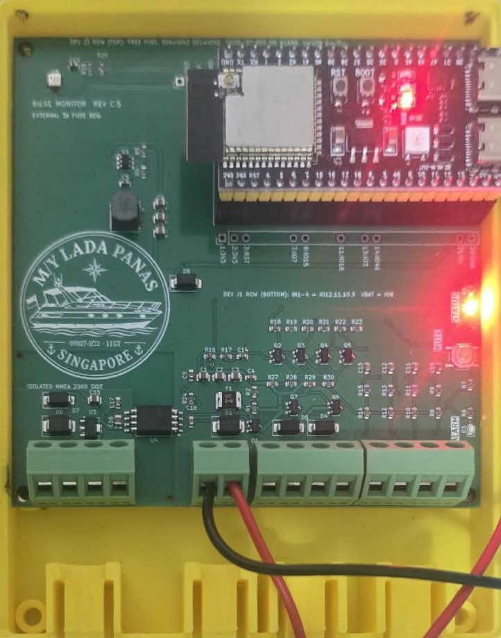

Board 1 running the alarm firmware from 12 V, in the printed enclosure base.

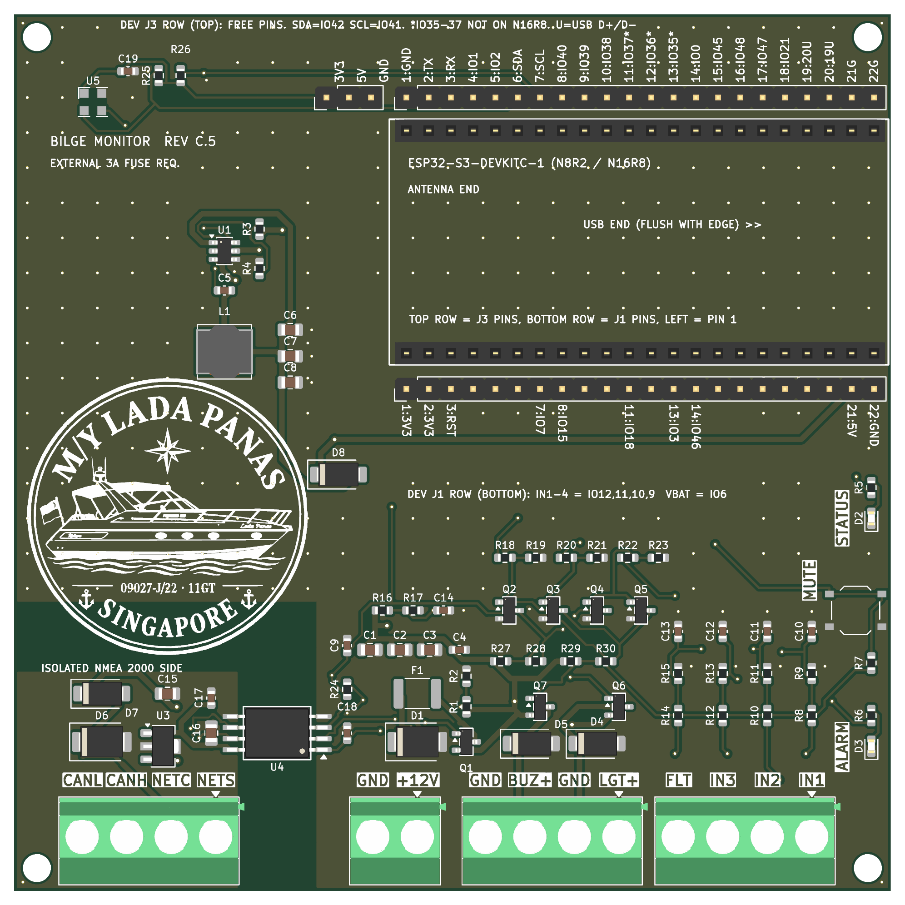

## 3D-printed enclosure
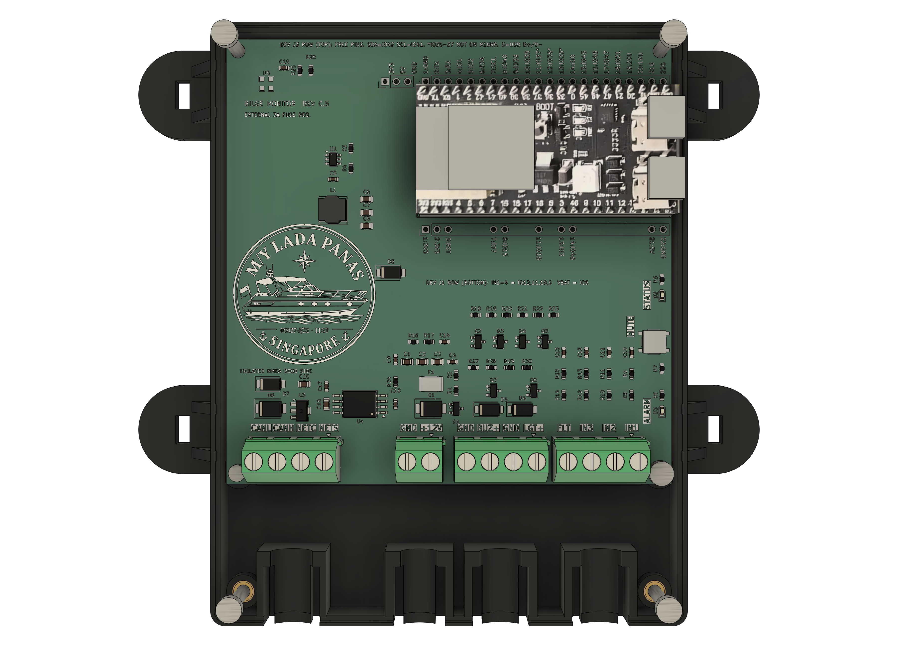

A two-part case (base + removable cover, M3 heat-set inserts, cable strain relief, tie-down lugs) designed to sit behind the helm display. The picture shows the base with the real board (KiCad 10 STEP export with silkscreen) and the ESP32 dev board fitted, cover off. Print files, the parametric Fusion script and rebuild instructions are in [`case/`](case/README.md). **Printed in November 2026; the photo at the top shows the real board in the printed base.**

## Gallery
**The real thing** (November 2026): the dev-board sockets with their pin labels, and the ESP32-S3 dev board that plugs into them.

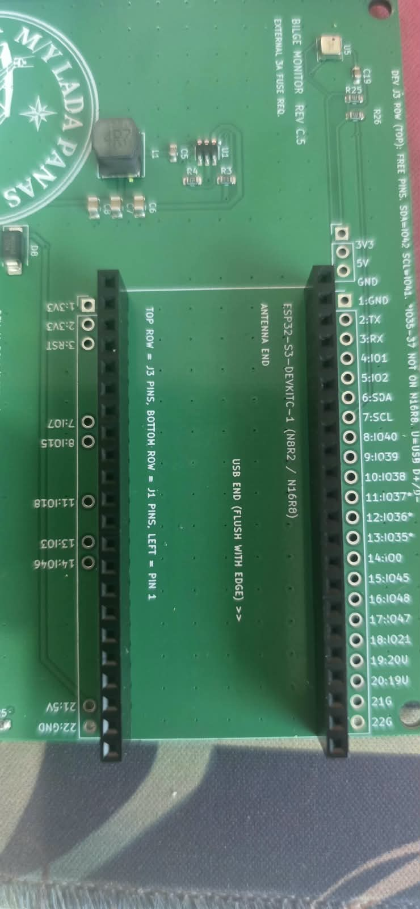 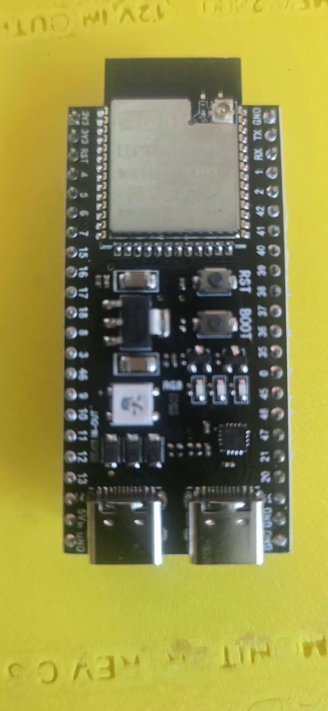

**The board** (Rev C.5, KiCad 10 ray-traced renders of the real design file):

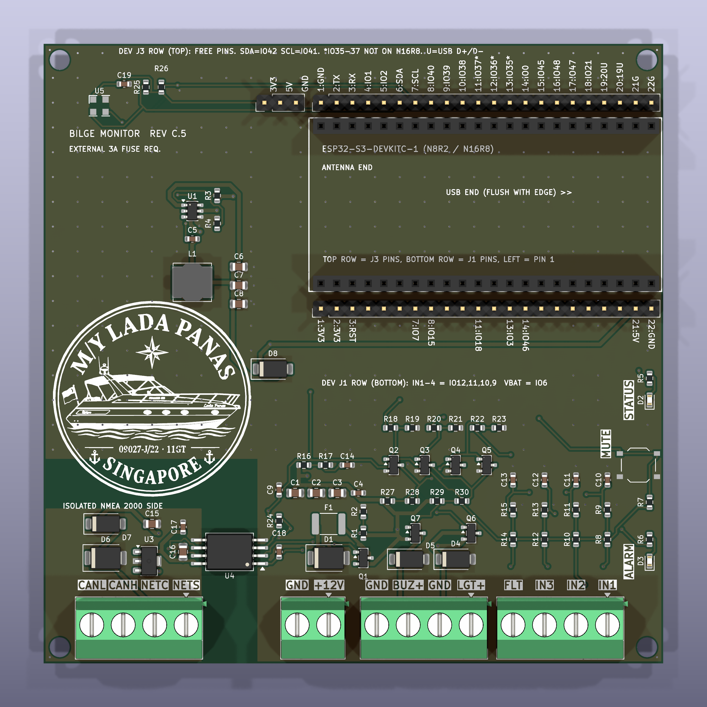
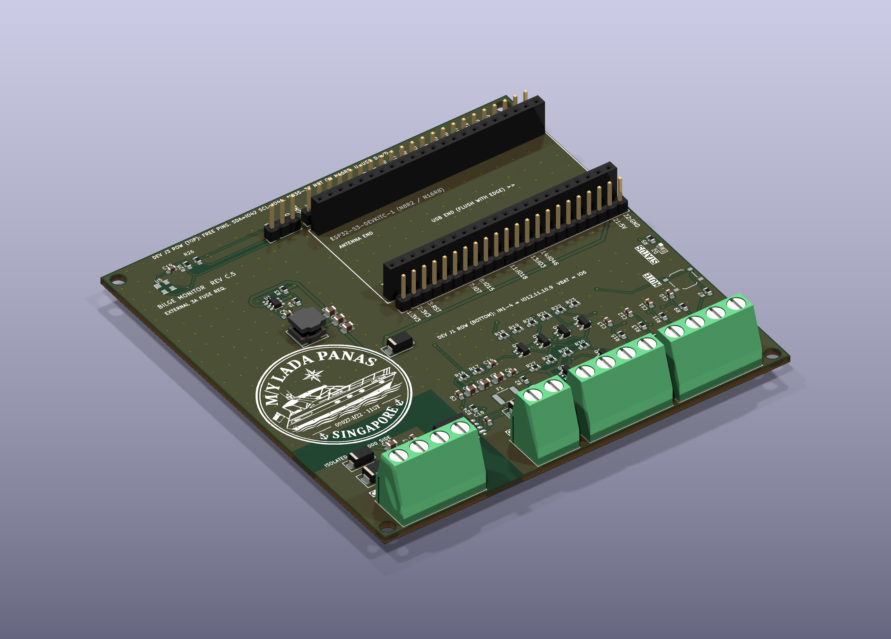
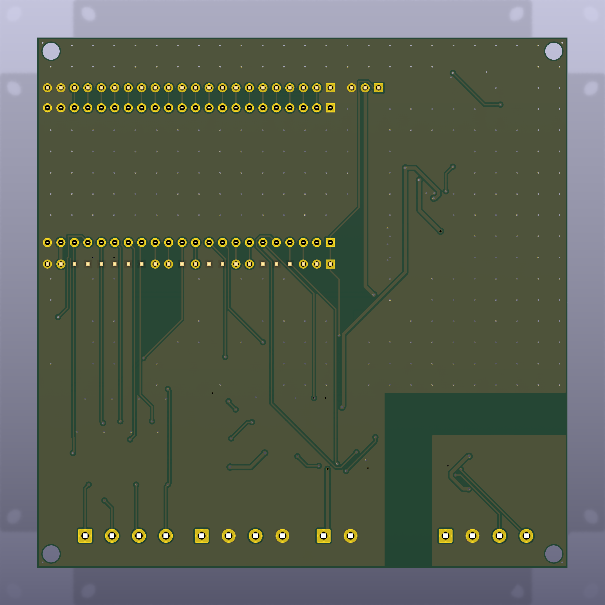

**The enclosure** (Fusion renders; the board and the ESP32 dev board are the real models/photo):

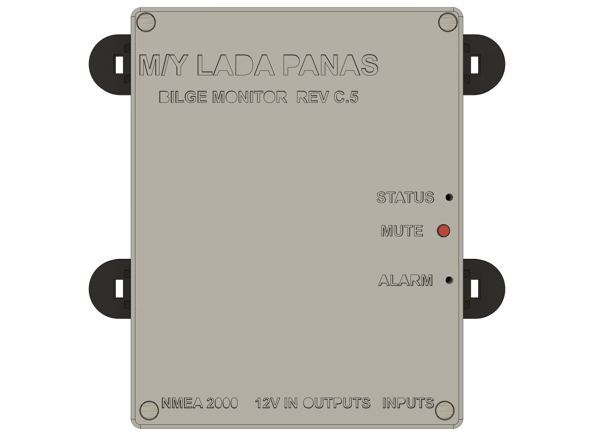
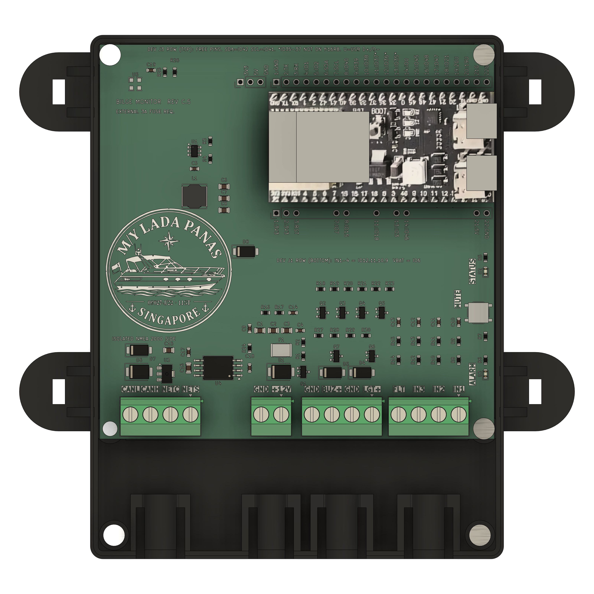


## What it does
- **Brain:** ESP32-S3-DevKitC-1 clone (N8R2/N16R8) on two 1x22 sockets. The ESP32 module is not assembled by JLCPCB's Economic service, so the dev board is bought separately and plugged in.
- **Power:** 12 V boat battery in, reverse-polarity P-FET, 24.4 V TVS, 2 A PPTC, AP63205 5 V buck feeding the dev-board 5V pin through a Schottky (the dev board makes 3.3 V).
- **Inputs:** three pump-sense inputs and a high-water float (100k/27k dividers, ADC), supply-voltage sense, MUTE button.
- **Outputs:** light and buzzer switched on the **positive** (high-side AO3401A P-FETs, driven by AO3400A), flyback diodes, and a **hard-wired bypass** so the float turns both outputs on even if the ESP32 is dead.
- **NMEA 2000:** CA-IS3050G isolated CAN transceiver (5 kVrms), 8.85 mm copper gap, bus-side L78L05 supply.
- **Sensor:** TE MS5637-02BA03 pressure + temperature on I2C 0x76 (compartment temperature; no humidity).
- **Indicators:** two red LEDs (status, alarm), widely spaced.
- **Extras:** all unused dev-board pins plus 3V3 / 5V / GND and SDA/SCL are broken out on numbered pad rows for solder-on sensors; four M3 corner holes for a 3D-printed case; the Lada Panas logo (32 mm) on the silkscreen.

## Firmware
The alarm firmware is in [`firmware/bilge_alarm`](firmware/bilge_alarm/README.md) (version 1.0.0-rc1, Arduino core for ESP32, built with arduino-cli or the Arduino IDE). It runs on board 1.

- **Alarms:** high water (float), pump running too long, pump starting too often, supply voltage low. Limits are set on the web page.
- **Counts since power-on:** how often and how long each input was on, how often each alarm was raised, and a log of the last 80 events. They survive a restart and a firmware update.
- **Web page** on the boat's Wi-Fi, with every reading the board has. If the board cannot join its saved network it opens its own setup hotspot, where a network can be chosen. Firmware updates are uploaded from the same page.
- **NMEA 2000:** pump and float states, supply voltage, pressure, temperature, and alarms as alert messages for a chartplotter (written for a Raymarine Axiom). Not yet tried on a network.
- **Bluetooth:** advertises as a RuuviTag temperature and pressure sensor for a Victron Cerbo GX. Not yet tried against a Cerbo.

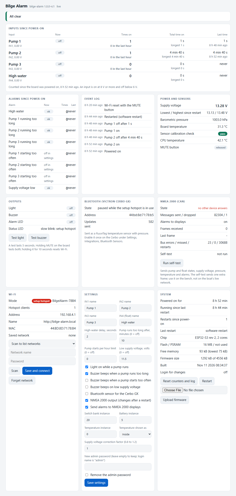

The page as served by board 1 on the bench, in setup-hotspot mode. Nothing is connected to the NMEA 2000 port, so that card reads "no other device answers".

## Repository layout
| Folder | Contents |
|---|---|
| `docs/` | Design decisions, dev-board pin map, holistic review, JLCPCB quotes and sensor comparison, bring-up checklist, DRC and verification output |
| `firmware/` | `bilge_alarm/` is the alarm firmware, `bench_test/` the sketch used to check a new board (arduino-cli, ESP32 Arduino core 3.x). Build, flash and bench instructions are in `firmware/README.md`; the research behind the NMEA 2000, Signal K and Victron choices is `docs/FIRMWARE_ARCHITECTURE.md` |
| `kicad/` | KiCad 10 board: `bilge_n2k_revC.kicad_pcb` (placed, unrouted) and `bilge_n2k_revC_routed.kicad_pcb` (final) |
| `gen/` | Python generators: `design_revC.py` is the single source of the netlist and BOM; `build_pcb.py` places the board; `route_clean.sh` autoroutes (Freerouting) until DRC is clean; `verify_board.py`, `fix_silk.py`, `fix_refs.py`, `export_fab.sh`, `make_quote_files.py`, `make_logo.py` do the rest. `fp/` holds the custom MS5637 footprint |
| `case/` | 3D-printed enclosure: STL/STEP in `print/`, parametric Fusion script in `BilgeCase/`, KiCad STEP exports and ESP32 texture in `ref/`, renders, build notes in `case/README.md` |
| `quote_jlcpcb/` | Files uploaded to JLCPCB: Gerbers + drill zip, BOM, CPL (Economic assembly, top side) |
| `mfg/` | Assembly and copper previews, netlist |
| `logo/` | Source logo and the silkscreen preview |
| `datasheets/` | Datasheets, dev-board dimension drawings and the clone photos used for the footprint; see `SOURCES.md` |
| `review/` | Self-contained zip for an independent reviewer |

## Rebuilding
Needs KiCad 10, Java 25 and Freerouting 2.5 (paths are set at the top of `gen/route.sh`), Python 3 with OpenCV for the logo.
```
python3 gen/design_revC.py            # netlist, BOM, cost
kicad-python gen/build_pcb.py         # place the board (KiCad's bundled Python)
gen/route_clean.sh                    # route until DRC is clean
gen/verify_board.py, gen/fix_silk.py, gen/fix_refs.py, gen/export_fab.sh, gen/make_quote_files.py
```
`gen/make_all.sh` shows the original sequence. Scripts assume this folder layout.

## Ordering (JLCPCB)
Economic assembly, top side, 5 boards: **US$92.12** at the last quote (PCB $4.00, assembly $88.12 including an $18.54 extended-component fee), 26 BOM lines. The MS5637 is flagged "difficult to process" by JLCPCB and must be ticked by hand; they may refuse or surcharge it (fallback: leave it unpopulated and hand-solder). Details in `docs/QUOTES_revC.md`.

## Test status and known risks
The board works as designed in everything tested so far. All testing has been on the bench with board 1; nothing has run on the boat yet. Full results are in `docs/BENCH_RESULTS.md`.

| Area | State |
|---|---|
| Power from 12 V (reverse-polarity FET, 5 V buck) | Tested, works |
| Dev board on the sockets: pin order, power pins, flashing over USB | Tested, works |
| Inputs IN1 to IN4 with 12 V applied | Tested, work |
| Supply voltage reading | Tested, works (read 13.15 V on the bench supply) |
| Pressure and temperature sensor (MS5637, custom footprint) | Tested, works |
| Status LED, MUTE button | Tested, work |
| Wi-Fi, setup hotspot, web page, firmware update over Wi-Fi | Tested, work |
| Alarm logic, counters, event log | Tested with the low-voltage alarm and real 12 V on two inputs |
| Light and buzzer outputs | **Pending.** The pins switch, but no load has been connected |
| Hard-wired float bypass, alarm LED | **Pending** |
| NMEA 2000 | **Pending field test.** The firmware sends with no network attached and never holds anything up; the port has not been on a real network |
| Bluetooth to the Cerbo GX | **Pending.** Advertising runs; not tried against a Cerbo |

Risks closed by the bench test:
- The dev-board clone's pin order and its 3V3 / 5V / GND pins were taken from seller photos and a drawing. They are right: the board runs on the sockets and every tested function is on the expected pin.
- The custom MS5637 footprint and JLCPCB's manual-review risk: the sensor was assembled, answers and passes its calibration check.

Risks still open:
- **Outputs.** The high-side light and buzzer stage has never driven a real load, and the hard-wired bypass (float switches both outputs without the ESP32) has not been tried.
- **NMEA 2000.** Untested on a network. The alarm messages (PGN 126983 / 126985) are built by hand and checked only against the canboat database; a Raymarine Axiom needs LightHouse 4 v4.8.164 or later to show them. The heat of the L78L05 on a 14 to 16 V bus has not been measured.
- **Supply reading.** Single readings jump by up to 1 V with Wi-Fi on; the firmware filters them. The reading may stop rising at about 14.1 V, to be confirmed with an adjustable supply.
- **IN1 and IN2 share their converter (ADC2) with Wi-Fi.** No failed reading so far (about 2.5 million each over a nine-hour run, in hotspot mode and on a normal network); the firmware counts failures and shows them. A next board revision should move them to ADC1.
- **One unexplained restart.** The board once reported a brownout as its last restart cause on the bench. It may only have been the moment 12 V was switched on.
- **USB and 12 V connected at the same time** has not been tested.
- **By design:** while the float is up, the hardware holds light and buzzer on and MUTE cannot silence them.
- **Network access is basic.** Anyone on the same network can read the page; changes ask for a login only once an admin password is set.
- The autorouted layout has not been reviewed by a human (buck loop, CAN pair), and nothing has been measured for emissions.
- Only board 1 has been powered, and only on the bench: no heat, vibration or damp-air exposure yet.

Earlier design notes: `docs/HOLISTIC_REVIEW_revC3.md` and `docs/BRINGUP_CHECKLIST.md`.

## Revision history (short)
Rev C.1-C.3: JLCPCB-only, high-side outputs, MS5637, 100 x 100 mm, I/O on one edge. Rev C.4: re-layout for the clone's real 25.40 mm row spacing. Rev C.5: external-review fixes (22 uF buck output caps, 22k gate pull-ups so |Vgs| stays under 12 V, 470 ohm LED resistors, 2 A PPTC), full silkscreen cleanup, Lada Panas logo.

Datasheets and vendor drawings in `datasheets/` belong to their manufacturers and are included for reference only.
