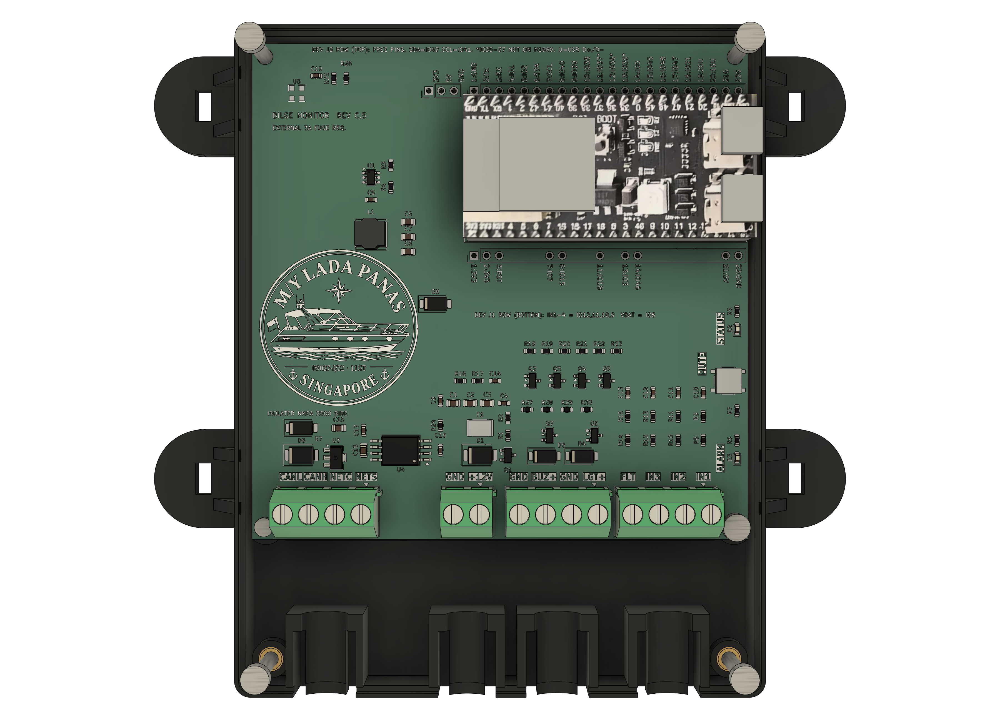

# Bilge alarm enclosure (3D-printed, Rev C.5 board)

Two-part case for the 100 x 100 mm bilge-alarm PCB, designed in Autodesk Fusion with a Python script, so the whole thing is parametric and reproducible. **Status: modelled, checked for clashes against the real PCB, and printed (November 2026). The real board sits in the printed base; see the photo in the main README.**



| | |
|---|---|
| Size | body 104.8 x 132.8 mm, 140.8 mm wide with the tie-down lugs; base 15.5 mm high, closed height 30.5 mm |
| Walls | 2.0 mm all round, floor and ceiling (5 perimeters / 5 layers with a 0.4 mm nozzle) |
| Cable inlets | four round holes (9-10 mm), one per terminal block, each with a half-round cradle about 2 cm in front of the terminal, with a tie slot either side of the cable and a tunnel under it. The slots and tunnel are open to the back (through the cable-end wall), so a tie loop slides in from outside and pulls the cable down into the cradle |
| ESP32 | 29 mm wide slot in the right wall for both USB-C ports; 5 mm of air above the board (see Heat) |
| Indicators | 2.2 mm light-pipe bores over the STATUS and ALARM LEDs, separate plunger for the MUTE button |
| Mounting | four lugs (4 mm thick, ribbed up the wall) with 6.4 x 3.2 mm slots for cable ties |

## Print files
[`print/`](print/): `case_base`, `case_cover`, `mute_plunger` as STL and STEP. **The STL files are already in print orientation** (base floor down, cover flipped so its flat top face is on the bed, plunger standing up); the STEP files are in the model orientation. `tools/orient_for_print.py` makes the print STLs from the exported ones.

- Print every part exactly as loaded (no rotating). I checked the print-orientation STL files for surfaces that face downward by more than 45 degrees from vertical:
  - **Base: supports needed in one place only, under the flat roof of each tie corridor** (4 places, about 100 mm2 each, directly under the cable cradles). The corridor is 12.4 mm wide, 3.5 mm tall (z 3.0 to 6.5) and open at the back and through the two tie slots above it. The support rests on the corridor floor, not the bed, so use "support everywhere" with a support blocker or enforcer so the slicer only adds support inside the four corridors. Break it out through the open back with pliers or a hook. Keep the support-to-part gap at about 0.2 mm so the roof stays smooth where the tie runs. `ROOF_CHAMFER = True` in the script gives a 45 degree chamfered roof that prints without support, if you would rather not.
  - **Cover (top down): no supports.** The rounded top edge sits on the bed (its first layers step out slightly more than 45 degrees, which slicers handle), and the engraved letters are 0.8 mm bridges over strokes about 1 mm wide. The screw counterbores end in a 45 degree cone seat, the USB slot, cable inlets, tubes and pads are open or vertical.
- 0.4 mm nozzle, 0.2 mm layers, 5 perimeters. **ASA** is the safest choice, PETG is acceptable, PLA is not (see Heat). First print: November 2026.
- The MUTE plunger prints standing up on its 3.6 mm stub (use a brim); its flange is a 45 degree cone, no support.

## Hardware
| Qty | Part |
|---|---|
| 5 | M3 heat-set insert, Voron style (Ruthex M3x5x4: 5.0 mm OD, 4.0 mm long). Pilot holes are 4.4 mm and 4.8 mm deep |
| 1 | **M2 heat-set insert**, about 3.5 mm OD x 3 mm long (pilot hole 3.2 mm x 4 mm deep, `M2_SPEC`; check your insert's datasheet): the bottom-left PCB post |
| 4 | **M3 x 25** socket-head cap screw: cover to base, one in each corner (the top two go through the PCB holes; see the calculation below) |
| 1 | **M3 x 6** socket-head cap screw: PCB to base at the bottom-right mounting hole |
| 1 | **M2 x 5** socket-head cap screw: PCB to base at the bottom-left mounting hole (head 3.8 mm, small enough to clear the J4 terminal block) |
| 4+ | cable ties up to 5 mm wide and 1.5 mm thick: one per cable cradle (slots are 5.2 x 2.2 mm), plus any for the tie-down lugs |
| 2 | 1.75 mm clear filament offcut (optional light pipes for the two LEDs) |

The inserts and screws are drawn in the CAD only as a non-printed reference component ("Hardware", brass inserts and steel screws) so you can see where everything goes. The printed parts just have the 4.4 mm holes.

## How the PCB and the cover are held
- **Cover to base:** four M3x25 screws, one in each corner. The top two are at the top-left and top-right PCB mounting holes: each goes down a tube in the cover, through the PCB hole, into an insert in the base post. The bottom two are at the two corners next to the cable inlets, in the same kind of post (6.0 mm high, same insert), outside the PCB.
- **PCB, cable side:** both bottom holes are screwed to their posts. Bottom-right: M3x6 into an M3 insert. Bottom-left: **M2x5** into an M2 insert, because the J4 terminal block is only 2.6 mm from that hole (measured on the KiCad model; 2.1 mm if the real block matches the Degson drawing). An M3 head (2.75 mm radius) would overlap the block by 0.1-0.6 mm, an M2 head (1.9 mm radius) clears it by 0.2-0.7 mm. If you would rather use M3 there, set `PCB_SPEC['BL'] = M3_SPEC` and check the block on the real board first.
- **PCB, top edge:** the cover has three hold-down pads (22 mm x 2.8 mm each) over the strip along the top edge, which has no components (only silkscreen and vias). They stop 0.1 mm above the board, and a rib in the base supports the board underneath, so the board is clamped between them without being bent. `HOLD_GAP = 0` makes the pads touch.
- **The cover never touches the ESP32.** Its ceiling is 5 mm above the tallest ESP32 part.

### Screw length (cover to base)
| | z (mm, floor underside = 0) |
|---|---|
| Cover top surface | 30.5 |
| Counterbore for the 3.0 mm tall M3 head | 3.2 deep, head seat at **27.3** |
| PCB top / post top (insert top) | 7.6 / **6.0** |
| Insert (4.0 mm long) | 2.0 to 6.0 |
| Pilot hole bottom | 1.2 |
| Screw tip (M3x25) | **2.3**, i.e. 3.7 mm inside the insert |

Screw length = head seat - tip = 27.3 - 2.3 = **25.0 mm**. All four corners use the same posts, inserts and length. An M3x20 would stop 5 mm short (tip 7.3, above the post). An M3x30 would bottom out in the pilot hole at z 1.2 before the head seats. The length is computed in the script (`CLOSE_SCREW_L`), so changing `ESP_CLEAR` or `DEV_SPACER` changes it; with a 28 mm case (`ESP_CLEAR = 2.5`) the same formula gives M3x22.

PCB screws: head seat z 7.6 (board top), 1.6 mm PCB, 6.0 mm posts. BR: M3x6 ends at z 1.6, through the whole 4 mm insert (z 2.0 to 6.0) and 0.4 mm into the pilot hole; M3x8 would bottom out. BL: M2x5 ends at z 2.6, through the 3 mm M2 insert (z 3.0 to 6.0) and 0.4 mm into its pilot hole (bottom at z 2.0).

## Heat: how much air above the ESP32?
**There is no published millimetre rule for this**, so this is an estimate plus a margin, not a standard.

- **Limit that matters is the module, not the cover.** The ESP32-S3-WROOM-1 **N16R8** is rated **-40 to 65 degC ambient** (the 85 degC rating belongs to other variants) [Espressif datasheet](https://www.espressif.com/sites/default/files/documentation/esp32-s3-wroom-1_wroom-1u_datasheet_en.pdf).
- **Plastics:** PLA softens around 55-65 degC ([JLC3DP](https://jlc3dp.com/blog/pla-temperature-resistance)), PETG around 75-85 degC with a lower HDT of 65-75 degC ([Snapmaker](https://www.snapmaker.com/blog/petg-glass-transition-temperature/)), ASA roughly 100 degC ([Sovol](https://www.sovol3d.com/blogs/news/best-high-temperature-filament-functional-parts)). Secondary sources, check your filament's datasheet.
- **Estimated heat (not measured):** the ESP32 module plus the dev board's LDO about 0.3 W with Wi-Fi off, the 5 V converter and the bus-side L78L05 a few tenths of a watt more, so call it about 1 W for the whole board. The case has about 0.04 m2 of surface; at roughly 8 W/m2K (convection plus radiation) that raises the inside air about 3 K above ambient. The module shield runs maybe 10-20 K above the inside air.
- **So at 50 degC behind the display** the air around the module is about 53 degC (inside the 65 degC rating) and the cover surface about 52 degC. The cover will not melt in PETG or ASA at this power. At 60 degC ambient you are at the module's limit, which is the real constraint. Measure the first install with a thermocouple.
- **Why 5 mm of air (`ESP_CLEAR`):** a physics estimate in a patent says free convection between two plates only starts above about 18 mm of gap at a 5 K difference ([USPTO](https://image-ppubs.uspto.gov/dirsearch-public/print/downloadPdf/7256991)), which this case cannot offer, so heat leaves through the case surface, not through the gap. 5 mm is a practical margin: it keeps the cover off the module even if the soldered headers sit 2.5 mm lower or higher than assumed (`DEV_SPACER` 0 to 2.5 mm) and clears plug tolerances. If you want more cooling: print in ASA, keep the helm location below about 55 degC, or add vent slots over the module (not done: the case is meant to stay closed against moisture).

## How it goes together
1. Melt the 6 inserts into the base posts: five M3 (bottom-right, top-left, top-right PCB posts and the two corner posts at the cable end) and one M2 (bottom-left PCB post).
2. Drop the PCB onto the four 6.0 mm posts and fix it with **1 x M3x6** at the bottom-right hole and **1 x M2x5** at the bottom-left hole.
3. Plug in the ESP32 dev board. Lay each cable in its half-round cradle. Then, outside the case, form a loose loop of cable tie around the cable close to the wall (head on top), and **slide the loop forward along the cable**: its two legs go into the open slots either side of the cable and its bottom run into the tunnel under the cable, until the loop stops at the closed end of the slots (about 2 cm from the terminals). Pull the tie tight: it draws the cable down into the groove. Nothing has to be threaded down a closed hole.
4. Drop the MUTE plunger into its guide tube from inside the cover.
5. Close the cover (tongue into the rim step) and fasten it with **4 x M3x25**, one in each corner tube.

## Reopening the Fusion model
[`fusion/bilge_alarm_case_revC5.f3d`](fusion/bilge_alarm_case_revC5.f3d) is the complete Fusion archive (8.4 MB): base, cover, mute plunger, the real KiCad board and the ESP32 dev board reference. Open it in Fusion with *File > Open > Open from my computer*. The same model is saved in the author's Fusion cloud as "Bilge alarm case Rev C.5". Rebuilding from the script (below) gives the same printable parts.

## Rebuilding the CAD
1. **KiCad 10** (the board file is KiCad 10 format; KiCad 9 can't open it). STEP of the populated board (the unpopulated `BR*` breakout headers are left out):
   ```
   kicad-cli pcb export step --force --component-filter "C*,D*,F1,HDR*,J*,L1,Q*,R*,SW3,U*" --include-silkscreen --include-soldermask --include-pads -o case/ref/bilge_pcb_kicad_silk.step kicad/bilge_n2k_revC_routed.kicad_pcb
   ```
   Drop `--include-*` for the light version (`bilge_pcb_kicad.step`). The mute-button and fuse models are missing from KiCad's library; the CAD uses plain boxes for them.
2. **Fusion**: *Utilities > Add-Ins > Scripts > +*, pick the `BilgeCase/` folder and run `BilgeCase`. It builds base, cover and plunger, exports STL and STEP to `BilgeCase/out/` (git-ignored; copy to `print/`) and checks clashes against a populated-PCB reference. Set `WITH_REF = False` at the top to skip the reference. Edit `KICAD_MODELS` to your KiCad 3D-model folder.
3. **Parameters** are at the top of `BilgeCase.py`: wall, clearances, insert and screw sizes, `PCB_SCREWS` / `CLOSE_SCREWS` (which corners), hold-down pads (`HOLD_GAP`, `HOLD_X`), air above the ESP32 (`ESP_CLEAR`), inlet radii, `DEV_SPACER`.
4. **Visual reference only** (not needed to print): [`BilgeCase/visuals/`](BilgeCase/visuals/) holds the scripts that placed the KiCad board and put the ESP32 photo (`ref/esp32_top_flat.png`, a perspective-corrected listing photo) on the dev-board stand-in. They contain absolute paths from the author's machine: edit before use.
5. [`tools/ClaudeBridge/`](tools/ClaudeBridge/) is the small Fusion add-in used to drive Fusion from Claude Code (runs Python files dropped in its `inbox/` folder). Not required; only install it if you want that workflow.

## Assumptions not yet verified (check on the first print and first real board)
- **ESP32 seating height.** The clone ("Soldered" variant) has its header plastic under the board, so I assumed it stops 2.5 mm above the 8.5 mm sockets (`DEV_SPACER = 2.5`). If you slide the plastic up the pins, set `DEV_SPACER = 0.0` (the case becomes 28 mm and the closing screws M3x22).
- **ESP32 clone dimensions** (27.94 x 57.15 mm, USB-C port heights) come from the seller's drawing and photos; there is no vendor 3D model.
- **Terminal blocks**: clearance was checked against the Degson DG127S-5.08 drawing (12.0 deep, 10.8 tall, 21.32 mm for 4 poles) as a stand-in for the DORABO DB127S. KiCad's own model is the Phoenix MKDS part, which is smaller.
- **Cable tie slots**: they are open to the outside through the cable-end wall, so a thin gap (2.2 mm wide) remains beside each cable. The plastic between the tunnel and the inlet hole under the cable is only 0.8 mm. Check on the first print that a real tie slides in, and that the strap you use fits (slots are 5.2 x 2.2 mm).
- **Heat figures above are estimates**, not measurements.
- **M2 insert and screw at the bottom-left corner**: the dimensions in `M2_SPEC` (3.5 mm OD x 3 mm insert, 3.2 mm pilot hole, 3.8 x 2.0 mm head) are typical values, check them against the parts you buy.
- MUTE button height (1.5 mm) and travel, and the 0.4 mm cover-joint clearance, are estimates.
